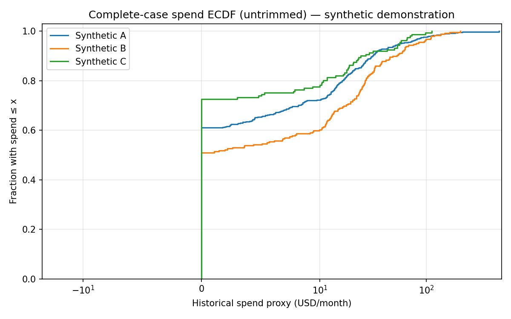

# Survey-Based Market Screening & Spending Sensitivity

A Dataquest guided-project origin, followed by an independent rebuild and audit. The historical source is the [freeCodeCamp 2017 New Coder Survey](https://github.com/freeCodeCamp/2017-new-coder-survey). The hypothetical product teaches web/mobile development. This is **exploratory survey screening**, not an estimate of market size, subscription conversion, causal advertising response or current demand.

## Method

Select respondents whose stated job-role interests match web/mobile developer. Rank up to four countries by respondent count among those with known residence; this is a survey composition statistic, not national demand. Report the known-country denominator, unknown country count and spend completeness separately. The spend proxy is reported money spent learning divided by months programming (zero months replaced with one, with a half-month sensitivity). Negative, nonnumeric, nonfinite or missing inputs are excluded from spend calculations, not from known-country respondent counts. Zero spend is retained. The denominator is months programming, not verified months of purchases or subscriptions.

Use the **untrimmed valid complete cases** for means, medians, the ECDF and thresholds at $10, $20, $30 and $59. Compare deletion above and capping at $100/$250/$500/$1000 as separate sensitivity estimands. Neither rule proves which observations are erroneous. Percentile bootstrap intervals for median spend describe conditional resampling variability, not population representativeness; zero medians can give degenerate intervals. Small samples and tied/discrete data require caution.

For threshold p, let N be eligible respondents with known country in the group, n the valid spend cases and k the number among those cases with spend >= p. The complete-case proportion is k/n (undefined when n=0); the worst-case all-N bounds are [k/N, (k+N-n)/N]. These are deterministic missing-data bounds, **not confidence intervals**, and do not solve missing residence or selection into the survey. Historical expenditure is not willingness to pay for this product, nor an upper bound on conversion: both existing spenders and nonspenders may choose differently.



## Controlled validation (100 synthetic worlds)

In each world, 500 observations per group: A has spend 0/20/1000 with probabilities .60/.32/.08; B has spend 0/80 with probabilities .50/.50. Large values in A are legitimate by construction. Raw A mean exceeded B in 100/100 worlds; deleting values above $500 reversed this ranking in 100/100, whereas capping at $500 reversed it in 21/100. Median A-minus-B raw/trimmed/capped gaps were $45.96/-$33.12/$6.16. In A, observing spend with probability .4 for spend >=$20 and .9 otherwise led to a median complete-case threshold error of -16.67 percentage points (5th–95th: -19.49 to -14.42 pp). Worst-case bounds contained the realised full-cohort threshold share in 100/100 worlds, as guaranteed by their construction. These are mechanism demonstrations, not estimated frequencies for real markets. See `reports/known_truth_audit.json` for seed and world-level outputs.

## Historical evidence and outstanding real-data run

The original archive's recommendation JSON recorded 45.34% US survey share, and trimmed mean spend $39.73 for the US versus $24.32 India, $26.22 UK and $27.90 Canada. These and the original figure are retained under `reports/legacy/`, not presented as freshly validated results. The raw CSV was absent and remote download failed during this audit. A fresh real-data run is outstanding. No current advertising-budget recommendation is justified; costs, addressable audience, acquisition, conversion, retention and margins would require independent evidence and ideally a controlled campaign test. The 2017 convenience survey is dated and self-selected.

## Reproduce

```bash
pip install -r requirements.txt pytest
pytest -q
python src/analyze.py --synthetic
python src/audit.py
# Real survey, when network/data available:
python src/download_data.py
python src/analyze.py --data data/raw/fcc_survey_2017.csv --output reports/real_2017
python src/price_points.py --data data/raw/fcc_survey_2017.csv --output reports/real_2017/price_points.json
```

The primary report and compatibility price-point command use the same population and threshold calculation. Real inputs require an explicit output path and carry file hash provenance; do not overwrite synthetic outputs. The download command fails rather than substituting synthetic data. Tests cover schema, denominators, invalid spend, thresholds, missingness bounds, sensitivity and reproducibility. Original and current test counts: 2 and 17 passing locally. See `docs/METHODOLOGY.md`. Licence: MIT for code; upstream survey terms apply to data.
